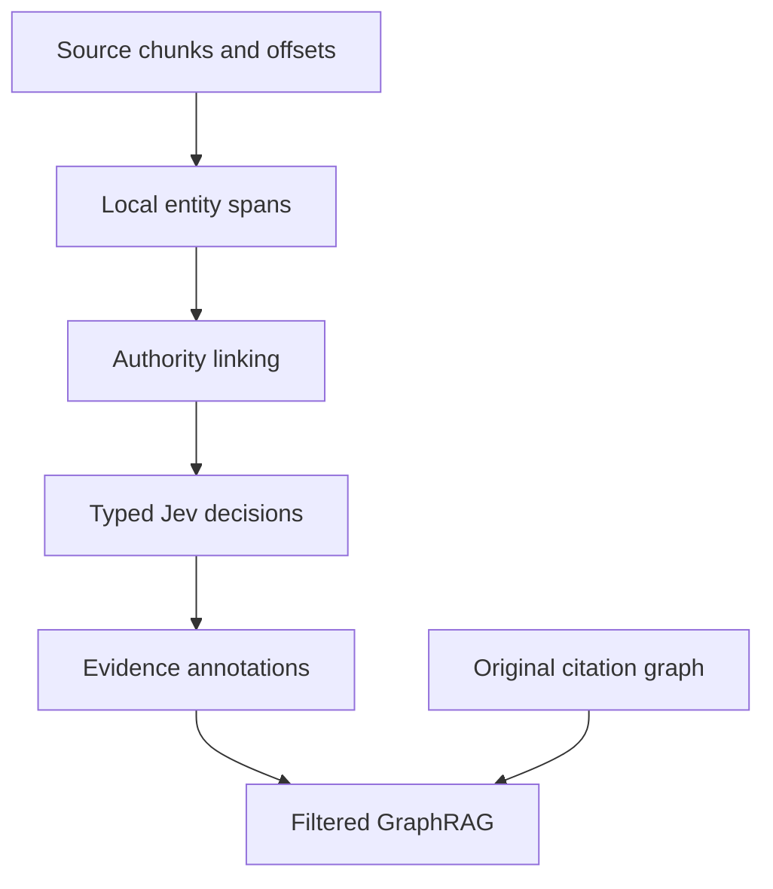

# System design document

## Pipeline
Source document -> immutable chunk and offsets -> pretrained local GLiNER2.5 spans -> deterministic authority linking -> candidate-specific Jev decisions -> source-level annotations -> filtered graph retrieval. Existing citation data remains independently available throughout. Lightweight LangGraph orchestrates validation, traversal, ranking and response; direct execution is the comparison implementation.

## Records
Keep authority IDs exact. Edges use canonical source, target and kind even when traversed backwards. Store source hashes, passage offsets, candidate identity, question/schema/prompt versions, requested and served provider/model, full distributions, cost and elapsed time. Retain denied, hypothetical, prospective, uncertain and contradictory annotations. Filtering produces a view; it never deletes original facts or judgments.

## Retrieval contract
Public tests define legal_graph.retrieval.retrieve and retrieve_workflow. Input nodes have id; edges have source, target, kind. Output has nodes, edges, missing_seeds, paths, parameters, truncated and truncation_reasons. Default direction incoming, kinds cites, depth one. Depth zero includes known seeds. Empty or all-missing seeds return empty results with missing IDs; mixed seeds still process known seeds. Invalid limits are errors. Positive budgets and hard output caps are enforced. Sort identities deterministically, deduplicate equal identities and exact edges, and retain parallel kinds. Select induced allowed-kind edges among reached nodes under budgets. Paths use shortest traversal with canonical endpoints and a reverse boolean.

## Storage
Use existing workspace SQL for app-owned canonical records through scoped Octo access. Use compatible hosted FalkorDB traversal when the existing API and graph ownership safely support it. Native ledger projection is a rebuildable ledger view and must not be repurposed as an arbitrary citation import endpoint. NetworkX provides a reproducible local reference, not a claim that hosted traversal has been delivered.

## Failure handling
Decision transport, malformed responses and missing judgments produce explicit unavailable/review states. Never convert provider failure into support. Cache keys include source content, span offsets, candidate and all decision versions. Do not infer legal treatments from authority titles. No credential enters source control, fixtures or receipts.

## Interfaces and evaluation
ABA receives API schemas, design direction and generated copy artifacts. Freeze graph revision, passage corpus, questions, labels and ranking parameters per experiment. Compare citation-only, extraction annotations and decision-filtered retrieval on the same questions, k and budgets. Report recall@k, nDCG@k, grounding errors, cost, latency and abstention. Until real passages and labels exist, report synthetic structural tests and operational benchmarks separately.
